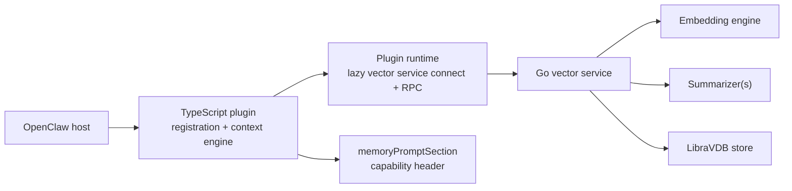

# System Architecture

This document describes the current implemented architecture at a public,
operational level. It intentionally avoids implementation anchors and detailed
internal sequencing.

## Overview

LibraVDB Memory is split into two cooperating pieces:

- a TypeScript OpenClaw plugin that owns the `memory` slot and registers
  context-engine capability at runtime
- a Go vector service that owns storage, retrieval, and compaction

The plugin keeps the host integration light and stable. The vector service keeps the
data path local-first and handles the expensive memory operations outside the
main chat process.

## Component Map

## Runtime Flow

### `memoryPromptSection`

The memory prompt hook returns a small static capability header. It is not the
main retrieval path.

### Background service shutdown

Terminal runtime cleanup stops Markdown and dream watchers and waits for active
scans before flushing and closing the shared client. This also applies when a
Gateway stop or plugin deletion arrives before the host's service-stop callbacks.
Concurrent shutdown callers wait for the same drain, flush, and close operation.

### `ingest`

Session messages are written into the vector service-backed store. User turns may also
be promoted into durable user memory after gating.

Durable turn commits checkpoint only the message prefix acknowledged by the
daemon. Partial acknowledgements and explicit rejections leave the turn
retryable, including after engine replacement. Cursor-gap recovery keeps its
pending state until the full recovery batch is confirmed. Protobuf cursor
integers are checked before conversion to local indices; an invalid cursor
cannot fall back to optimistic success. Successful responses from older
daemons without cursors retain their compatibility behavior.

Messages without host IDs use stable advancement IDs and source positions in
both normal ingestion and recovery, so an exact commit replay after restart
still matches the persisted checkpoint.

### `assemble`

The context engine queries the relevant memory scopes, ranks the results, fits
them to the current token budget, and injects the selected items as synthetic
system messages.

Recall reuse is limited to the same user-turn boundary and daemon client.
Replacing a client does not reuse its cached recall or inherit its retrieval
failure state. Predictions produced after ingestion are also discarded if a
different client handles the next assembly.

### `compact`

Compaction is explicit rather than background-only. The host can request a
compaction pass, and the system then decides whether the current session is
eligible. When it does compact, it preserves the newest working context, turns
older content into smaller summaries, and keeps the raw recent tail intact.

If the input is too small or the compactable portion does not clear local
thresholds, compaction declines instead of forcing a rewrite.

## Current Boundaries

- `memoryPromptSection` stays lightweight
- retrieval happens in `assemble`
- compaction is separate from prompt construction
- lifecycle hints such as `before_reset` and `session_end` are advisory
- the vector service is the source of truth for stored memory state
- engine disposal drains only ingestion submitted by that engine, with a bounded
  deadline; other engines retain their queues and shared session caches

## Failure Handling

The plugin is designed to degrade gracefully:

- if the vector service is unavailable, prompt assembly continues without recall
- if compaction fails, the active session is not blocked
- if summarization is unavailable, the system falls back to the safer path

That keeps the chat usable even when the memory backend is temporarily down.

## Why This Shape

This architecture keeps the host integration simple while still supporting:

- separate session, durable-user, and global scopes
- bounded prompt assembly
- explicit compaction
- local-first storage and retrieval

In short, the plugin owns the lifecycle contract, and the vector service owns the
heavy lifting.
